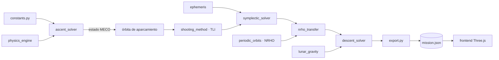

# Hoja de ruta: Simulador Artemis IV

> Documento vivo. Aquí está **qué tenemos, qué hay que mejorar y cómo llegar al simulador completo**: las 5 fases de la misión con visualización 3D interactiva.
> Revisión inicial: 27 de octubre de 2026. Actualiza las casillas `[ ]` → `[x]` a medida que avancen.

**Integrantes:** Mariana Lopera Correa · Juan José Becerra Bedoya · Daniel Santiago Machado
**Referencia visual:** <https://oulmentescreativas.netlify.app/>, un visualizador Sol–Tierra–Luna en Three.js con marcos de referencia, línea de tiempo, capas y manual integrado.

---

## Índice
1. [Cómo usar este documento](#1-cómo-usar-este-documento)
2. [Estado actual del proyecto](#2-estado-actual-del-proyecto)
3. [Revisión: qué está bien y qué mejorar](#3-revisión-qué-está-bien-y-qué-mejorar)
4. [La meta: cómo se verá el simulador completo](#4-la-meta-cómo-se-verá-el-simulador-completo)
5. [Hoja de ruta por etapas](#5-hoja-de-ruta-por-etapas)
6. [Arquitectura objetivo](#6-arquitectura-objetivo)
7. [Convenciones que no se negocian](#7-convenciones-que-no-se-negocian)
8. [Calendario sugerido y división del trabajo](#8-calendario-sugerido-y-división-del-trabajo)
9. [Riesgos y cómo evitarlos](#9-riesgos-y-cómo-evitarlos)
10. [Referencias](#10-referencias)

---

## 1. Cómo usar este documento

- **Trabajen por etapas, en orden.** Cada etapa tiene: objetivo, la física y matemática necesarias, tareas, archivos, pruebas y un **criterio de "terminado"**. No se pasa a la siguiente sin cumplir ese criterio.
- **Regla de oro del proyecto:** *ninguna función física entra sin una prueba que compare contra un valor conocido* (analítico, publicado o un caso límite). Así hemos trabajado hasta ahora y es lo que da credibilidad al proyecto.
- **Cada etapa termina con:** pruebas en verde (`python -m pytest`), figuras regeneradas (`python scripts/generate_figures.py`) y una línea en el [registro de cambios](#registro-de-cambios) al final de este archivo.

---

## 2. Estado actual del proyecto

### Lo que ya funciona ✅

| Módulo | Qué hace | Estado |
|---|---|---|
| `src/artemis_sim/constants.py` | Tierra, Luna y etapas del SLS Block 1B (masas, empujes, Isp) | ✅ Probado |
| `src/artemis_sim/state.py` | Vector de estado inmutable `[r, v, m]` | ✅ Probado |
| `src/artemis_sim/physics_engine.py` | Gravedad, atmósfera exponencial + temperatura US76, Mach, Cd(M), arrastre, empuje | ✅ Probado |
| `src/artemis_sim/ascent_solver.py` | Fase 1: ascenso completo (SRB → separación → Core → MECO), guiado de tangente lineal, eventos | ✅ Probado |
| `src/artemis_sim/ephemeris.py` | Luna en órbita circular con n kepleriano | ✅ Probado |
| `src/artemis_sim/symplectic_solver.py` | CR3BP geocéntrico, Verlet, RK4, DOP853, energía, integral de Jacobi | ✅ Probado |
| `src/artemis_sim/shooting_method.py` | TLI por método del disparo + Newton, semilla de Kepler | ✅ Probado |
| `scripts/generate_figures.py` | 8 figuras + `results.json` + `results.tex` | ✅ |
| `tests/` | 63 pruebas automáticas | ✅ Todas pasan |
| `docs/paper/final/` | Informe LaTeX de 14 páginas | ✅ |
| `docs/presentation/` | Presentación de 23 diapositivas (.pptx + .pdf) | ✅ |

**Resultados clave actuales:** Max-Q 27,5 kPa · MECO a 160 km con 6,60 km/s · TLI de 3 150 m/s en 5 iteraciones · Jacobi conservada a ~1e-5.

### Lo que existe pero está vacío ⚠️

| Archivo | Situación | Qué hacer |
|---|---|---|
| `frontend/index.html`, `frontend/js/*.js`, `frontend/css/style.css` | 0 líneas | ✅ Construidos en la **Etapa 2** |
| `src/export_data.py` | 0 líneas | ✅ Eliminado; se creará `src/artemis_sim/export.py` en la **Etapa 1** |
| `src/orbital_solver.py`, `src/physics_engine.py` | 0 líneas, **duplicaban nombres** del paquete real | ✅ Eliminados |
| `docs/architecture.md` | 0 líneas | ✅ Escrito |
| `requirements.txt` | Vacío | ✅ Completo |
| `notebooks/01_integrador_rk45.ipynb`, `02_extraccion_datos_nasa.ipynb` | Vacíos (no eran JSON válido) | ✅ Eliminados |

### Lo que falta por completo ❌
- **Fase 4:** inserción en la órbita NRHO de Gateway.
- **Fase 5:** descenso del HLS al polo sur lunar.
- **Visualización 3D** de las trayectorias.
- Un **pipeline único** que encadene las 5 fases en una sola trayectoria.

---

## 3. Revisión: qué está bien y qué mejorar

### Fortalezas (mantenerlas)
1. **Separación por capas** (datos → física → solvers): permite agregar fases sin romper lo anterior.
2. **Unidades SI explícitas** en los nombres (`mu_m3_s2`, `thrust_vac_n`).
3. **Funciones puras + estado inmutable:** fáciles de probar.
4. **Verificación con valores conocidos** (orden de convergencia, conservación, reversibilidad, experimento gemelo).
5. **Reproducibilidad:** los números del informe salen del código (`results.tex`).

### Mejoras, por prioridad

#### 🔴 P0: arreglar antes de seguir (Etapa 0)
- [x] **Eliminar los archivos vacíos que confunden:** `src/orbital_solver.py` y `src/physics_engine.py`. Este último tiene el mismo nombre que el módulo real del paquete.
- [x] **`requirements.txt` vacío:** cualquiera que clone el repo no puede instalarlo. Además, `pyproject.toml` no declara `matplotlib`, que `scripts/generate_figures.py` necesita.
- [x] **README desactualizado:** dice "Fase 1" y no explica cómo correr nada.
- [x] **mypy reporta 1 error** en `ascent_solver.py:199` (`no-any-return` en `pitch_kick_direction`). Se arregla con un `np.asarray(..., dtype=np.float64)`.
- [x] **Generador de la presentación fuera del repo:** `docs/presentation/build_deck.js` depende de `pptxgenjs`, que no está declarado. Agregar `docs/presentation/package.json`.

#### 🟡 P1: mejoras de fidelidad física (Etapa 6, cuando las fases estén completas)
| Simplificación actual | Efecto | Mejora | Dónde |
|---|---|---|---|
| Luna en órbita circular coplanar con el ecuador | La órbita real está inclinada entre 18° y 29° respecto al ecuador y es excéntrica (e ≈ 0,055) | Efemérides **JPL DE440** con `jplephem` o `spiceypy` | `ephemeris.py` |
| Plataforma en el meridiano de referencia en t = 0 | Ignora la hora real del lanzamiento | Calcular el **tiempo sidéreo de Greenwich (GMST)** a partir de una fecha UTC | `ascent_solver.py` |
| Órbita de aparcamiento ecuatorial | Desde KSC la inclinación real es ≥ 28,5° | Usar el estado real del MECO + la inserción de la EUS como estado inicial de la TLI | `pipeline.py` (nuevo) |
| TLI impulsiva | Ignora unos 20 min de combustión y las pérdidas por gravedad | **Combustión finita** de la EUS (integrar empuje + masa) | `symplectic_solver.py` / nuevo `burns.py` |
| Tierra esférica | Sin achatamiento: la precesión nodal de la órbita LEO se pierde | Término **J₂** | `physics_engine.py` |
| Sin perturbación solar | Error de algunos km en 4 días | Sol como 4.º cuerpo (con DE440) | `symplectic_solver.py` |
| Guiado en vacío orientado con `v_rel` | La inclinación deriva de 28,6° a 31,7° durante el ascenso (rumbo de 90° a 109°): el empuje sigue el "este local" en lugar de mantener el plano inercial | En `linear_tangent_direction`, usar la velocidad **inercial** (`v_rel + ω×r`) fuera de la atmósfera y volver a ajustar θ₀ y θ_f. Cambia los números del MECO, así que hay que regenerar el informe | `ascent_solver.py` |
| RS-25 sin estrangulamiento | 3,5 g en el MECO; el real limita a ~3 g | Throttle por límite de aceleración y en Max-Q | `ascent_solver.py` |
| Atmósfera exponencial para la densidad | Error de ~20 % sobre 30 km | Densidad US76 completa por capas (ya tenemos la temperatura) | `physics_engine.py` |
| Datos de la EUS "pendientes de verificar" | El programa Artemis se está reestructurando | Revisar contra fuentes de la NASA y documentar la fecha de consulta | `constants.py` |

#### 🟢 P2: calidad de ingeniería
- [x] **Integración continua:** GitHub Actions que corra `pytest`, `ruff` y `mypy` en cada push.
- [x] **`docs/architecture.md`** con el diagrama de módulos (mermaid).
- [ ] **Notebooks didácticos** reales: uno por fase, para explicar en clase.
- [ ] **Medir rendimiento:** el método del disparo tarda unos 10 s; con NRHO y descenso habrá que vectorizar o usar `numba`.

---

## 4. La meta: cómo se verá el simulador completo

Inspirado en la referencia, pero aplicado a **nuestra misión**:

```
┌──────────────────────────────────────────────────────────────────────────┐
│ ARTEMIS IV · T+ 3d 14h 22m      FASE 3 · TRÁNSITO     v = 1.02 km/s       │  ← HUD de telemetría
│ h_Luna = 41 230 km   m = 51.0 t   Jacobi ΔE/E = 9.7e-6                   │
├──────────────────────────────────────────────────────┬───────────────────┤
│                                                      │ MARCO             │
│        (vista 3D: Tierra, Luna, trayectoria          │ ○ ECI (Tierra)    │
│         coloreada por fase, nave, Gateway)           │ ● Rotante T-L     │
│                                                      │ ○ Selenocéntrico  │
│                                                      │ CAPAS             │
│                                                      │ ☑ Trayectoria     │
│                                                      │ ☑ Órbita lunar    │
│                                                      │ ☐ NRHO            │
│                                                      │ ☐ Vectores v, a   │
│                                                      │ ☐ Estrellas       │
├──────────────────────────────────────────────────────┴───────────────────┤
│ ◀◀  ▶  ▶▶   [■■■■■■■■■■■■▒░░░░░░░░░░░░░░░░░░]   ×1 ×10 ×100 ×1000         │  ← línea de tiempo
│ │Ascenso│Aparc.│      TLI → Tránsito       │ NRHO │Desc.│                  │  ← marcas de fase
└──────────────────────────────────────────────────────────────────────────┘
```

**Funcionalidades (todas inspiradas en la referencia):**
1. **Marcos de referencia intercambiables:** ECI, rotante Tierra–Luna (donde la NRHO se ve como un "halo" estático) y selenocéntrico (para el descenso).
2. **Línea de tiempo** con reproducción/pausa, velocidad ×1 a ×10 000, y **marcas de cada fase** para saltar directamente a ellas.
3. **HUD de telemetría:** tiempo de misión (T+), fase, altitud, velocidad, masa y el invariante de Jacobi.
4. **Capas activables:** trayectoria, órbita lunar, NRHO, vectores de velocidad y aceleración, estrellas.
5. **Cámara:** orbitar, desplazar y zoom; atajos para "seguir a la nave", "ver Tierra" y "ver Luna".
6. **Manual integrado** (tecla `H`) con la física de cada fase y fórmulas renderizadas con KaTeX.
7. **Atajos de teclado:** espacio = pausa, 1/2/3 = marco, ←/→ = fase anterior/siguiente.
8. **Accesibilidad:** opción de reducir movimiento, igual que la referencia.

**Tecnología:** igual que la referencia, **Three.js 0.160 como módulos ES** con un `importmap`, sin compilador ni Node. Se abre con un servidor estático simple (`python -m http.server`) y se puede publicar en Netlify o GitHub Pages.

---

## 5. Hoja de ruta por etapas

```
Etapa 0  Limpieza ─────────┐
Etapa 1  Exportación ──────┤  (puente Python → web)
Etapa 2  Visualizador v1 ──┤  ← ya se puede mostrar lo que existe (Fases 1–3)
Etapa 3  NRHO (CR3BP) ─────┤
Etapa 4  TLI → NRHO ───────┤  ← Fase 4 completa
Etapa 5  Descenso HLS ─────┤  ← Fase 5 completa
Etapa 6  Integración final ┘  + mejoras de fidelidad (P1)
```

> **¿Por qué el visualizador va antes de las fases nuevas?** Porque ver la trayectoria es la mejor herramienta para **detectar errores** en la NRHO y el descenso. Además, ya tendríamos algo vistoso que mostrar con las Fases 1–3.

---

### Etapa 0: Limpieza y cimientos ✅ (terminada el 2026-10-27)
**Objetivo:** dejar el repositorio ordenado e instalable por cualquiera.
**Tiempo estimado:** 1 a 2 días.

**Tareas:**
- [x] Borrar `src/orbital_solver.py`, `src/physics_engine.py` y `src/export_data.py` (vacíos).
- [x] Llenar `requirements.txt`:
  ```
  numpy>=1.24
  scipy>=1.10
  matplotlib>=3.7
  pytest>=7.0
  ```
  y agregar `matplotlib` a `pyproject.toml` (en un extra `[project.optional-dependencies] plots`).
- [x] Arreglar el error de mypy en `ascent_solver.py:199`.
- [x] Reescribir `README.md`: qué es, cómo instalar, cómo correr las pruebas, cómo generar figuras y cómo abrir el visualizador.
- [x] Escribir `docs/architecture.md` con un diagrama mermaid de los módulos.
- [x] Notebooks: se eliminaron los dos archivos vacíos (no eran JSON válido). Los tutoriales por fase quedan como tarea P2.
- [x] Crear `docs/presentation/package.json` con `pptxgenjs` como dependencia.
- [x] Crear `.github/workflows/ci.yml` (pytest + ruff + mypy).

**Terminado cuando:** `git clone` → `pip install -r requirements.txt` → `pytest` funciona en una máquina limpia, y la integración continua está en verde.

---

### Etapa 1: Exportación de trayectorias (puente Python → web) ✅ (terminada el 2026-10-27)
**Objetivo:** que Python escriba un archivo con la trayectoria que el navegador pueda leer.
**Tiempo estimado:** 3 a 4 días.

#### Formato de datos: el "contrato" entre Python y JavaScript
Archivo `frontend/data/mission.json`:

```json
{
  "schema_version": 1,
  "generated_utc": "2026-11-02T15:00:00Z",
  "units": { "length": "km", "time": "s", "velocity": "km/s", "mass": "t" },
  "frame": "ECI_J2000",
  "bodies": {
    "earth": { "radius_km": 6378.137 },
    "moon":  { "radius_km": 1737.4, "orbit_radius_km": 384400.0, "mean_motion_rad_s": 2.6653e-6, "phase0_rad": 0.0 }
  },
  "phases": [
    { "id": "ascent",  "name": "Ascenso",  "t_start": 0,     "t_end": 480.5 },
    { "id": "parking", "name": "Órbita de aparcamiento", "t_start": 480.5, "t_end": 5400 },
    { "id": "transit", "name": "Tránsito translunar", "t_start": 5400, "t_end": 351000 }
  ],
  "events": [
    { "t": 64.8,  "label": "Max-Q" },
    { "t": 126.0, "label": "Separación de SRB" },
    { "t": 480.5, "label": "MECO" }
  ],
  "samples": {
    "t":  [0.0, 1.0, "..."],
    "x":  ["..."], "y": ["..."], "z": ["..."],
    "vx": ["..."], "vy": ["..."], "vz": ["..."],
    "m":  ["..."],
    "phase_index": [0, 0, "..."]
  },
  "diagnostics": { "jacobi": ["..."], "q_kpa": ["..."], "mach": ["..."] }
}
```

**Decisiones de diseño:**
- **Kilómetros** en el JSON (no metros): los números quedan más pequeños y legibles en la escena 3D. El código Python sigue en SI; la conversión ocurre **solo** en el exportador.
- **Columnas** (`"x": [...]`) y no una lista de objetos: el archivo es entre 3 y 4 veces más pequeño y se pasa directo a `Float32Array`.
- **Muestreo adaptativo:** cada 1 s en el ascenso, cada 60 s en el tránsito y cada 1 s en el descenso. Así se esperan unos 10 000 puntos, menos de 2 MB.
- **La Luna no se exporta punto por punto:** se envían `mean_motion` y `phase0`, y el navegador la calcula con la misma fórmula. Cuando usemos DE440 (Etapa 6), se exportará tabulada.

**Tareas:**
- [x] Crear `src/artemis_sim/export.py` con:
  - `MissionTrajectory` (dataclass): fases, eventos y arrays.
  - `concatenate_phases(...)`: une tramos y quita duplicados en los cortes.
  - `resample(traj, dt_by_phase)`: muestreo por fase, con interpolación Hermite cúbica que usa posición y velocidad.
  - `to_json(traj, path)`.
- [x] Crear `scripts/export_mission.py`, que corre ascenso → aparcamiento → TLI → tránsito y escribe `frontend/data/mission.json`.
- [x] **Puente ascenso → TLI** (en `src/artemis_sim/mission.py`): hoy la TLI arranca de una órbita circular ecuatorial "ideal". Hay que tomar el estado del MECO, aplicar la inserción de la EUS (impulsiva al principio) y propagar la órbita de aparcamiento hasta el punto de encendido de la TLI.

**Pruebas (`tests/test_export.py`):**
- [x] El JSON se puede releer, y `t` es estrictamente creciente.
- [x] Ida y vuelta: exportar → importar → error de posición < 1 m en los puntos originales.
- [x] La interpolación Hermite reproduce una órbita circular con error < 10 m a mitad de intervalo.
- [x] Las fases cubren `[0, t_final]` sin huecos ni solapamientos.

**Terminado cuando:** `python scripts/export_mission.py` genera `mission.json` < 5 MB que pasa las pruebas.

**Resultado obtenido:** `mission.json` de 0,57 MB con 6 637 muestras (ascenso cada 1 s, aparcamiento cada 20 s, tránsito cada 60 s). La misión encadenada da inserción de 1 211 m/s, TLI de 3 147 m/s en 5 iteraciones y llegada a 3 998 km de la Luna (objetivo: 4 000 km). Masa: 2 710 t → 136,7 t tras la inserción → 66,8 t tras la TLI. Se agregaron 12 pruebas (`tests/test_export.py`), 75 en total.

**Decisión de diseño, la ventana de lanzamiento:** desde Florida la órbita de aparcamiento queda inclinada. Para no pagar un cambio de plano, `LunarOrbitConfig` acepta ahora inclinación y nodo ascendente, y la misión elige la geometría lunar para que la Luna esté en el plano de aparcamiento y en el lugar correcto al llegar. Así se planifica una ventana real. La integral de Jacobi se generalizó a un plano lunar inclinado y tiene su prueba.

---

### Etapa 2: Visualizador 3D v1 ✅ (terminada el 2026-10-28)
**Objetivo:** ver en el navegador las Fases 1–3 con línea de tiempo, marcos de referencia y HUD.
**Tiempo estimado:** 1,5 a 2 semanas.

#### Estructura de archivos
```
frontend/
├── index.html            ← importmap de Three.js + estructura del HUD y los paneles
├── css/style.css
├── data/mission.json     ← generado en la Etapa 1
└── js/
    ├── main.js           ← arranque: carga datos, crea escena y conecta la interfaz
    ├── scene.js          ← Tierra, Luna, estrellas, luces, cámara, OrbitControls
    ├── trajectory.js     ← línea de la trayectoria coloreada por fase (Line2 / LineMaterial)
    ├── frames.js         ← transformaciones ECI → rotante → selenocéntrico
    ├── timeline.js       ← reloj de misión, velocidad, marcas de fase, ←/→
    ├── hud.js            ← telemetría en vivo
    ├── interpolate.js    ← Hermite cúbico (igual que en Python)
    └── manual.js         ← ventana de ayuda con KaTeX
```

#### Puntos técnicos clave
1. **Escala:** 1 unidad de escena = 1 000 km. Tierra: radio 6,378; Luna: a 384,4 unidades. Para el ascenso (0–160 km sobre una Tierra de 6 378 km) hay que **hacer zoom con cámara de seguimiento**; con escala real no se distingue.
2. **Precisión numérica en el GPU:** `Float32` tiene unos 7 dígitos. Para ver bien el descenso lunar (metros) estando a 384 400 km de la Tierra, hay que **recentrar la escena en el cuerpo enfocado** (técnica de "origen flotante"): restar la posición del objetivo en CPU con `Float64` antes de enviar al GPU.
3. **Marcos de referencia** (`frames.js`):
   - **ECI:** tal cual llegan los datos.
   - **Rotante Tierra–Luna:** girar cada punto un ángulo `−n·t` alrededor de z. La NRHO se verá como un halo fijo.
   - **Selenocéntrico:** restar `r_Luna(t)`.
4. **Interpolación entre muestras:** Hermite cúbico, que usa posición **y** velocidad, para que el movimiento sea suave a cualquier velocidad de reproducción.
5. **Texturas:** usar mapas de NASA de dominio público (Blue Marble, Lunar Reconnaissance Orbiter CGI Moon Kit). Guardarlos en `frontend/assets/` con su crédito.
6. **Sin compilador:** `importmap` con `three@0.160.0` desde jsDelivr, igual que la referencia.

**Tareas:**
- [x] Escena básica: Tierra con textura y rotación sidérea, Luna en su órbita, estrellas, cámara con OrbitControls.
- [x] Cargar `mission.json` y dibujar la trayectoria coloreada por fase.
- [x] Nave (un marcador) moviéndose sobre la trayectoria según el reloj.
- [x] Línea de tiempo: play/pausa, velocidad (×1 … ×10 000), barra arrastrable, marcas de fase y eventos.
- [x] Selector de marco: ECI / rotante / selenocéntrico.
- [x] HUD: T+, fase, altitud sobre el cuerpo más cercano, velocidad, masa.
- [x] Capas: trayectoria, órbita lunar, vectores, estrellas.
- [x] Atajos de teclado y manual (`H`).
- [x] Opción "reducir movimiento" y que funcione en el celular.
- [ ] Publicar en GitHub Pages o Netlify. *(pendiente: requiere configurar el repositorio)*

**Pruebas:**
- [x] `frontend/tests/frames.test.html` (o con Node): la transformación al marco rotante deja la Luna fija en (384,4; 0; 0).
- [x] La interpolación JS coincide con la de Python en 5 puntos de control (exportados en el JSON como `checkpoints`).
- [x] Prueba manual: los eventos (Max-Q, MECO, TLI) aparecen en el tiempo correcto del HUD.

**Notas de la v1:** texturas procedurales (retícula) en lugar de Blue Marble/LRO, sin KaTeX en la ayuda y `THREE.Line` en lugar de `Line2`; quedan como mejoras P2. Las pruebas viven en `frontend/tests/frames.test.mjs` (`node --test`).

**Terminado cuando:** se puede reproducir la misión de la Fase 1 a la 3, cambiar de marco sin saltos y el HUD coincide con `results.json`.

---

### Etapa 3: La órbita NRHO (base de la Fase 4)
**Objetivo:** calcular la órbita NRHO de Gateway dentro de nuestro modelo de tres cuerpos.
**Tiempo estimado:** 2 semanas. **Es la etapa matemáticamente más exigente.**

#### Física y matemática
1. **CR3BP adimensional.** Unidades: distancia Tierra–Luna = 1, periodo/2π = 1, μ = μ_L/(μ_E + μ_L) ≈ 0,01215. En el marco rotante baricéntrico:

   $$\ddot x - 2\dot y = \frac{\partial \Omega}{\partial x},\quad \ddot y + 2\dot x = \frac{\partial \Omega}{\partial y},\quad \ddot z = \frac{\partial \Omega}{\partial z},\qquad \Omega = \tfrac12(x^2+y^2) + \frac{1-\mu}{r_1} + \frac{\mu}{r_2}$$

   Es el **mismo modelo** que ya usamos en geocéntrico (con n kepleriano); solo cambian las coordenadas. Hay que verificar que ambos dan la misma constante de Jacobi.
2. **Puntos de Lagrange L1 y L2:** raíces de ∂Ω/∂x = 0 sobre el eje x, por Newton.
3. **Matriz de transición de estados (STM)** Φ(t): se integra junto con el estado,

   $$\dot\Phi = A(t)\,\Phi,\qquad A = \begin{pmatrix} 0 & I \\ \Omega_{rr} & 2J \end{pmatrix},\quad J=\begin{pmatrix}0&1&0\\-1&0&0\\0&0&0\end{pmatrix}$$

   Es un sistema de 6 + 36 = 42 ecuaciones. **Debe** integrarse con DOP853 y tolerancias de 1e-12.
4. **Corrección diferencial con simetría:** las órbitas de halo son simétricas respecto al plano xz. Se parte de (x₀, 0, z₀, 0, ẏ₀, 0), se integra hasta el siguiente cruce con y = 0, y se corrige (x₀ o z₀, ẏ₀) hasta que ẋ = ż = 0 en ese cruce. Es un Newton de 2×2 con la STM. **Reutiliza la lógica de `shooting_method.py`.**
5. **Continuación por familia:** empezar con una halo L2 pequeña (semilla de la aproximación lineal o de Richardson de tercer orden) y avanzar paso a paso en z₀ hacia la familia sur hasta llegar a las NRHO.
6. **Elegir la NRHO 9:2 de Gateway:** la que completa **9 órbitas cada 2 meses sinódicos**, con periodo ≈ 6,56 días. El perilunio queda a unos 3 000–3 500 km del centro de la Luna, sobre el polo norte, y el apolunio a unos 70 000 km, sobre el polo sur. Se hace un último Newton sobre el periodo.
7. **Estabilidad:** autovalores de la matriz de monodromía Φ(T). La NRHO 9:2 es "casi estable" (índice de estabilidad cercano a 1). Por eso Gateway necesita solo pequeñas correcciones.

**Archivos nuevos:**
- [ ] `src/artemis_sim/cr3bp.py`: ecuaciones adimensionales, Ω y sus derivadas, puntos de Lagrange, integración con STM y conversión rotante ↔ ECI dimensional.
- [ ] `src/artemis_sim/periodic_orbits.py`: semilla de Richardson, corrección diferencial, continuación y `find_nrho(period_days=6.56)`.

**Pruebas (`tests/test_cr3bp.py`, `tests/test_periodic_orbits.py`):**
- [ ] L1 y L2 coinciden con la tabla publicada para μ Tierra–Luna (x_L1 ≈ 0,8369 y x_L2 ≈ 1,1557 en unidades adimensionales).
- [ ] La STM de DOP853 coincide con diferencias finitas (error < 1e-6).
- [ ] La constante de Jacobi adimensional coincide con `compute_jacobi_constant` geocéntrica (ya implementada).
- [ ] Una halo corregida se cierra: |x(T) − x(0)| < 1e-9 (adimensional).
- [ ] La NRHO 9:2 tiene periodo de 6,56 ± 0,01 días y perilunio en el rango esperado.
- [ ] El determinante de la monodromía es 1, porque el flujo es simpléctico: Φᵀ J Φ = J.

**Terminado cuando:** `find_nrho()` devuelve la NRHO 9:2, las figuras muestran la familia de halos en el marco rotante y la órbita se ve en el visualizador (capa "NRHO").

---

### Etapa 4: Transferencia TLI → NRHO (Fase 4 completa)
**Objetivo:** que la trayectoria salga de la Tierra y **termine en la NRHO**, con el Δv de inserción que debe dar Orion.
**Tiempo estimado:** 1,5 a 2 semanas.

#### Física y matemática
1. **Transferencia de referencia:** Artemis I usó una trayectoria con un **sobrevuelo lunar propulsado** (*powered flyby*) y luego una inserción. Para el proyecto, la versión más simple y defendible es:
   - TLI (ya la tenemos) → **sobrevuelo lunar** cerca del perilunio de la NRHO → **maniobra de inserción (NRI)** en un punto de la NRHO.
2. **Disparo múltiple:** el viaje se divide en tramos (Tierra → cerca de la Luna → punto de inserción), cada uno con su estado inicial como incógnita, y se exige continuidad entre tramos. Es más robusto que el disparo simple que usamos ahora, porque el sobrevuelo lunar es muy sensible.
   - Incógnitas: Δv_TLI (3), estados intermedios (6 por nodo), tiempos de vuelo y punto de inserción en la NRHO (fase τ).
   - Restricciones: continuidad en cada nodo y llegada al estado de la NRHO salvo el Δv.
   - Objetivo: **minimizar |Δv_NRI|** con `scipy.optimize.minimize` (SLSQP) usando las restricciones de igualdad.
3. **Combustible de Orion:** comprobar con Tsiolkovsky que el Δv_NRI sea compatible con el módulo de servicio europeo de Orion (motor OMS-E, Isp ≈ 316 s). Documentar la fuente de los datos de Orion en `constants.py`.

**Archivos:**
- [ ] `src/artemis_sim/multiple_shooting.py`: formulación general (nodos, continuidad, jacobiano por bloques con STM).
- [ ] `src/artemis_sim/nrho_transfer.py`: semilla (la TLI actual + punto del perilunio) y optimización del Δv de inserción.
- [ ] Agregar `ORION` a `constants.py` (masa, Isp y empuje del OMS-E, con su fuente).

**Pruebas:**
- [ ] Disparo múltiple sobre un caso conocido (una órbita circular partida en 4 tramos): debe converger a continuidad exacta.
- [ ] El jacobiano por bloques coincide con diferencias finitas.
- [ ] La trayectoria final llega a la NRHO con error de posición < 1 km y de velocidad < 1 m/s.
- [ ] El Δv total (TLI + NRI) es del orden de los valores publicados para transferencias a la NRHO (documentar la referencia usada).

**Terminado cuando:** el visualizador muestra el vuelo Tierra → Luna → NRHO sin saltos, y el informe tiene una sección nueva con el presupuesto de Δv completo.

---

### Etapa 5: Descenso al polo sur con el HLS (Fase 5 completa)
**Objetivo:** simular el descenso propulsado desde la NRHO hasta la superficie, con la gravedad lunar real.
**Tiempo estimado:** 2 a 3 semanas.

#### Física y matemática
1. **Marco fijo a la Luna (rotación sincrónica):** la Luna rota con el mismo periodo con que orbita. El descenso se integra en un marco selenocéntrico fijo a la Luna, con fuerzas de Coriolis y centrífuga. **Aquí sí corresponden**, porque ese marco rota (justo lo contrario del ascenso en ECI).
2. **Gravedad en armónicos esféricos:**

   $$U(r,\phi,\lambda) = \frac{\mu_L}{r}\left[1 + \sum_{n=2}^{N}\sum_{m=0}^{n}\left(\frac{R_L}{r}\right)^n \bar P_{nm}(\sin\phi)\,(\bar C_{nm}\cos m\lambda + \bar S_{nm}\sin m\lambda)\right]$$

   - Coeficientes: modelo **GRGM1200A** de la misión GRAIL (archivo `.sha` del Planetary Data System de la NASA). Truncar en N = 50–100 para que sea rápido.
   - Legendre normalizados por **recurrencia estable** (columnas hacia adelante), nunca con fórmulas cerradas, que pierden precisión para n grande.
   - Gradiente: usar el **algoritmo de Pines o de Cunningham**, sin singularidad en los polos. **Es crítico, porque aterrizamos en el polo sur.**
3. **Fases del descenso:**
   1. Salida de la NRHO → órbita lunar baja (LLO) o descenso directo (decisión a documentar).
   2. **Frenado** (*braking*): reduce la velocidad orbital (~1,7 km/s en LLO).
   3. **Aproximación** (*approach*): el módulo se inclina para "ver" el sitio de alunizaje.
   4. **Descenso final:** vertical, velocidad < 1 m/s al tocar.
4. **Guiado:** guiado polinomial tipo **Apolo** (aceleración cuadrática en el tiempo hasta un objetivo de posición y velocidad) o **E-guidance**. Como extensión avanzada: **optimización convexa (G-FOLD)**, que es el estado del arte para aterrizajes propulsados.
5. **Masa variable:** ṁ = −T/(Isp·g₀) con los datos del HLS. Integrar con **RK45/DOP853 y eventos** (contacto con la superficie): otra vez un régimen **no conservativo**, igual que el ascenso. **La estructura del proyecto se repite, y es un buen argumento para el informe.**

**Archivos:**
- [ ] `scripts/fetch_grail.py`: descarga los coeficientes GRGM1200A del PDS y los guarda truncados en `data/grgm1200a_n100.npz`, con su fuente.
- [ ] `src/artemis_sim/lunar_gravity.py`: Legendre normalizados, potencial y gradiente sin singularidad polar.
- [ ] `src/artemis_sim/moon_frame.py`: transformación selenocéntrica inercial ↔ fija a la Luna.
- [ ] `src/artemis_sim/descent_solver.py`: dinámica, guiado polinomial, eventos y `simulate_descent(...)`.
- [ ] Agregar `HLS` a `constants.py` (con la fuente; los datos públicos son limitados, así que hay que documentar las suposiciones).

**Pruebas:**
- [ ] Con N = 0, el potencial es exactamente μ/r (masa puntual).
- [ ] Solo con J₂ (C₂₀), la aceleración coincide con la fórmula analítica de J₂.
- [ ] El gradiente coincide con diferencias finitas del potencial, también **sobre el polo** (φ = −90°).
- [ ] Los Legendre normalizados cumplen la normalización (comparar con `scipy.special` hasta n = 20).
- [ ] El descenso termina con velocidad < 1 m/s, a < 100 m del sitio y con masa > masa seca.
- [ ] **Mascons visibles:** la desviación de una órbita baja con N = 100 respecto a la de masa puntual es de cientos de metros por órbita. Documentar el número.

**Terminado cuando:** el visualizador, en marco selenocéntrico, muestra el descenso hasta el polo sur, y el informe incluye el efecto de los mascons.

---

### Etapa 6: Integración final y mejoras de fidelidad
**Objetivo:** misión completa de las 5 fases en un solo comando, con el visualizador final y el informe actualizado.
**Tiempo estimado:** 1,5 a 2 semanas.

- [ ] `src/artemis_sim/pipeline.py`: `run_mission(config) → MissionTrajectory` encadena ascenso → aparcamiento → TLI → NRHO → descenso, con el estado de salida de cada fase como entrada de la siguiente.
- [ ] `scripts/run_mission.py` genera de una vez figuras, `results.json`, `results.tex` y `mission.json`.
- [ ] Mejoras P1 de la [sección 3](#-p1-mejoras-de-fidelidad-física-etapa-6-cuando-las-fases-estén-completas), en este orden de impacto: **DE440 → GMST/inclinación real → combustiones finitas → J₂ → Sol → estrangulamiento → densidad US76**.
- [ ] Visualizador: la misión de las 5 fases, cámara cinemática por fase y modo "presentación" con recorrido automático.
- [ ] Informe: secciones nuevas (NRHO, transferencia, descenso) y figuras.
- [ ] Presentación actualizada.

**Terminado cuando:** `python scripts/run_mission.py && python -m http.server -d frontend` muestra la misión completa y todas las pruebas están en verde.

---

## 6. Arquitectura objetivo

```
ArtemisIV-flight-dynamics/
├── src/artemis_sim/
│   ├── constants.py          ✅ (+ ORION, HLS)
│   ├── state.py              ✅
│   ├── physics_engine.py     ✅ (+ J₂, densidad US76)
│   ├── ascent_solver.py      ✅                     Fase 1
│   ├── ephemeris.py          ✅ (+ DE440)
│   ├── symplectic_solver.py  ✅                     Fases 2–3
│   ├── shooting_method.py    ✅                     Fase 3
│   ├── cr3bp.py              🆕 Etapa 3
│   ├── periodic_orbits.py    🆕 Etapa 3             NRHO
│   ├── multiple_shooting.py  🆕 Etapa 4
│   ├── nrho_transfer.py      🆕 Etapa 4             Fase 4
│   ├── lunar_gravity.py      🆕 Etapa 5             mascons
│   ├── moon_frame.py         🆕 Etapa 5
│   ├── descent_solver.py     🆕 Etapa 5             Fase 5
│   ├── export.py             🆕 Etapa 1
│   └── pipeline.py           🆕 Etapa 6
├── scripts/
│   ├── generate_figures.py   ✅
│   ├── export_mission.py     🆕 Etapa 1
│   ├── fetch_grail.py        🆕 Etapa 5
│   └── run_mission.py        🆕 Etapa 6
├── data/                     🆕 coeficientes GRAIL, efemérides (no versionar archivos > 50 MB)
├── frontend/                 🆕 Etapa 2 (Three.js)
├── tests/                    ✅ 63 → ~120 pruebas
└── docs/
    ├── ROADMAP.md            ← este archivo
    ├── architecture.md       🆕 Etapa 0
    ├── paper/final/          ✅
    └── presentation/         ✅
```

**Flujo de datos:**


---

## 7. Convenciones que no se negocian

| Tema | Regla |
|---|---|
| **Unidades en Python** | SI estricto (m, kg, s, rad). Unidad en el nombre: `altitude_m`, `thrust_vac_n` |
| **Unidades en la web** | km, s, km/s y t. La conversión ocurre **solo** en `export.py` |
| **CR3BP adimensional** | Solo dentro de `cr3bp.py` / `periodic_orbits.py`; las funciones públicas reciben y devuelven SI |
| **Marcos** | ECI J2000 por defecto. Cualquier otro marco se indica en el nombre: `r_rot`, `v_moon_fixed` |
| **Tiempo** | Segundos desde el despegue (T+). Cuando entre DE440, se agrega la época UTC del lanzamiento como metadato |
| **Integradores** | Régimen no conservativo (empuje, arrastre) → RK45/DOP853 con eventos. Régimen conservativo largo → Verlet. STM → DOP853 con tolerancia ≤ 1e-12 |
| **Datos externos** | Cada constante con su **fuente y fecha de consulta** en un comentario |
| **Pruebas** | Toda función física nueva se compara contra un valor analítico, publicado o un caso límite |
| **Commits** | Mensajes en **inglés**, en imperativo: `Feat: add differential correction for halo orbits` |

---

## 8. Calendario sugerido y división del trabajo

Estimación para unas 10 a 12 semanas a ritmo de proyecto de curso:

| Semana | Etapa | Mariana | Juan José | Daniel |
|---|---|---|---|---|
| 1 | 0. Limpieza | README, `architecture.md`, CI | `requirements`, mypy, archivos vacíos | Notebooks |
| 2 | 1. Exportación | Esquema JSON + pruebas | Puente ascenso → aparcamiento | Interpolación Hermite |
| 3–4 | 2. Visualizador | Interfaz: HUD, línea de tiempo, manual | Escena: Tierra, Luna, texturas, cámara | Marcos de referencia + trayectoria |
| 5–6 | 3. NRHO | Figuras y documentación | Puntos de Lagrange + STM | Corrección diferencial + continuación |
| 7–8 | 4. TLI → NRHO | Datos de Orion + presupuesto Δv | Visualización de la NRHO | Disparo múltiple + optimización |
| 9–10 | 5. Descenso | Datos del HLS + documentación | Gravedad GRAIL (armónicos) | Guiado + `descent_solver` |
| 11–12 | 6. Integración | Informe + presentación | Mejoras de fidelidad (DE440, J₂) | `pipeline.py` + pruebas finales |

**Rotación sugerida:** al terminar cada etapa, quien **no** la programó **revisa** el código (revisión cruzada). Así los tres entienden todo el proyecto.

---

## 9. Riesgos y cómo evitarlos

| Riesgo | Señal de alerta | Prevención |
|---|---|---|
| La corrección diferencial de la NRHO no converge | El residuo oscila o diverge | Continuación con pasos pequeños; nunca saltar directo a la NRHO |
| La STM pierde precisión | Φᵀ J Φ ≠ J | DOP853 con rtol = 1e-12; probar la condición simpléctica |
| Singularidad de la gravedad en el polo | NaN o aceleraciones enormes cerca de φ = ±90° | Algoritmo de Pines; prueba específica sobre el polo |
| Archivo de GRAIL demasiado grande | El repositorio pesa cientos de MB | Truncar en N ≤ 100 y no versionar el archivo original |
| La escena 3D "tiembla" cerca de la Luna | Saltos de la nave con zoom cercano | Origen flotante (recentrar en `Float64` antes del GPU) |
| Datos públicos incompletos (EUS, HLS) | Valores "pendientes de verificar" | Documentar suposiciones y hacer análisis de sensibilidad (±10 %) |
| Cambios en el programa Artemis de la NASA | Noticias de reestructuración | Revisar fuentes oficiales antes de cada entrega y anotar la fecha de consulta |
| Fin de semestre sin terminar | Etapas que se alargan | Las Etapas 0–2 ya dan un producto completo y presentable; las siguientes son incrementales |

---

## 10. Referencias

**Ya en el repositorio** (`docs/paper/articles/`): NASA SLS Fact Sheet (2023) · NASA SLS Lift Capabilities (2018) · NASA Artemis Plan (2020) · Sutton & Biblarz, *Rocket Propulsion Elements*.

**Para las etapas nuevas:**
- Szebehely, V. (1967). *Theory of Orbits: The Restricted Problem of Three Bodies* → Etapa 3.
- Howell, K. C. (1984). Three-dimensional, periodic, 'halo' orbits. *Celestial Mechanics*, 32 → corrección diferencial (Etapa 3).
- Richardson, D. L. (1980). Analytic construction of periodic orbits about the collinear points. *Celestial Mechanics*, 22 → semilla de halos (Etapa 3).
- Zimovan, E. M., Howell, K. C. & Davis, D. C. (2017). Near rectilinear halo orbits and their application in cis-lunar space → NRHO (Etapa 3).
- Lee, D. E. (2019). *Gateway Destination Orbit Model: A Continuous 15 Year NRHO Reference Trajectory*, NASA Technical Report → NRHO 9:2 de referencia (Etapa 3).
- Pavlak, T. A. (2013). *Trajectory Design and Orbit Maintenance Strategies in Multi-Body Dynamical Regimes*, tesis doctoral, Purdue → disparo múltiple (Etapa 4).
- Lemoine, F. G. et al. (2014). GRGM900C: A degree 900 lunar gravity model from GRAIL. *Geophysical Research Letters* / Goossens et al. (2016) GRGM1200A → Etapa 5.
- Pines, S. (1973). Uniform representation of the gravitational potential and its derivatives. *AIAA Journal*, 11 → gravedad sin singularidad (Etapa 5).
- Klumpp, A. R. (1974). Apollo lunar descent guidance. *Automatica*, 10 → guiado polinomial (Etapa 5).
- Açıkmeşe, B. & Ploen, S. R. (2007). Convex programming approach to powered descent guidance → G-FOLD, extensión opcional (Etapa 5).
- Vallado, D. A. *Fundamentals of Astrodynamics and Applications* → GMST, J₂ y marcos (Etapa 6).
- Documentación de Three.js r160 (<https://threejs.org/docs/>) y de SPICE / `jplephem` → Etapas 2 y 6.

> Antes de citar una cifra de estas fuentes en el informe, **verifíquenla en el documento original** y anoten la página.

---

## Registro de cambios

| Fecha | Etapa | Qué se hizo | Quién |
|---|---|---|---|
| 2026-10-15 | — | Revisión física del código, Fases 1–3 completas, informe y figuras | Equipo |
| 2026-10-16 | — | Presentación final y sustentación | Equipo |
| 2026-10-27 | — | Creación de esta hoja de ruta | Equipo |
| 2026-10-27 | 0 | Limpieza: archivos vacíos eliminados, `requirements.txt`, README, `architecture.md`, CI, mypy sin errores, generador de la presentación reproducible (`npm run build`) | Equipo |
| 2026-10-27 | 1 | Exportación a JSON por columnas (`export.py`), misión encadenada ascenso → aparcamiento → TLI → tránsito (`mission.py`), órbita lunar inclinada y Jacobi generalizado, 12 pruebas nuevas | Equipo |
| | | | |
