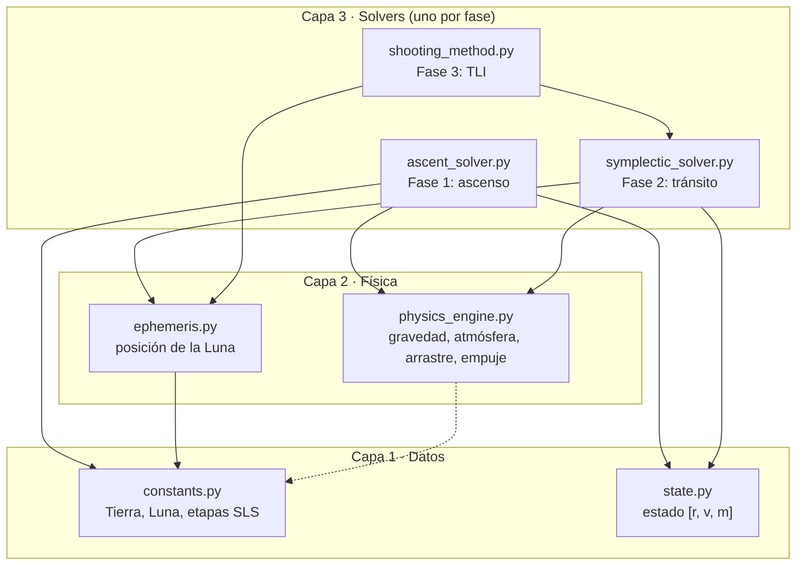
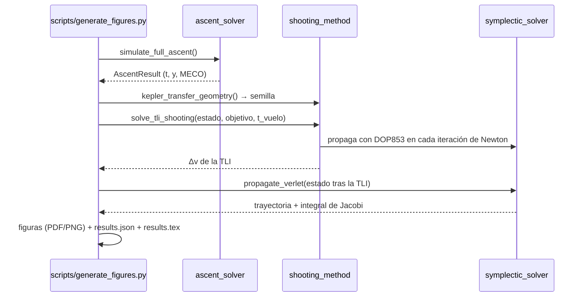

# Arquitectura del simulador

El paquete `artemis_sim` (en `src/artemis_sim/`) está organizado en **tres capas**: cada una solo depende de las de abajo.

## Módulos

| Módulo | Responsabilidad | Funciones y clases principales |
|---|---|---|
| `constants.py` | Constantes físicas inmutables y validadas | `CelestialBody`, `StageSpec`, `EARTH`, `MOON`, `SLS_B1B_*` |
| `state.py` | Vector de estado `[x, y, z, vx, vy, vz, m]` inmutable | `ArtemisState` |
| `physics_engine.py` | Funciones físicas puras (sin estado) | `compute_gravity`, `compute_aerodynamic_drag`, `compute_thrust`, `compute_mach_number`, `compute_drag_coefficient` |
| `ephemeris.py` | Órbita lunar circular con movimiento medio kepleriano | `get_body_position`, `get_body_velocity`, `LUNAR_MEAN_MOTION_RAD_S` |
| `ascent_solver.py` | EDO del ascenso, guiado, eventos y simulación completa | `make_ascent_derivatives`, `linear_tangent_direction`, `simulate_full_ascent` |
| `symplectic_solver.py` | CR3BP geocéntrico e integradores | `compute_n_body_acceleration`, `propagate_verlet`, `propagate_rk4`, `compute_jacobi_constant` |
| `shooting_method.py` | Problema de valores en la frontera de la TLI | `solve_tli_shooting`, `numerical_jacobian`, `kepler_transfer_geometry` |
| `cr3bp.py` | CR3BP adimensional baricéntrico: Ω y derivadas, STM (42 EDO, DOP853 1e-12), puntos de Lagrange, rotante ↔ ECI | `propagate`, `lagrange_points`, `jacobi_constant`, `rotating_to_eci` |
| `periodic_orbits.py` | Halos L2 por corrección diferencial y continuación; NRHO 9:2 de Gateway | `correct_halo`, `continue_family`, `find_nrho` |
| `mission.py` | Encadena las Fases 1–3 (ascenso → aparcamiento → TLI → tránsito) con la ventana de lanzamiento | `build_mission_phases_1_to_3` |
| `export.py` | Remuestreo con Hermite cúbico y exportación a JSON por columnas para la web | `MissionTrajectory`, `resample`, `to_json`, `from_json` |

## Flujo de un cálculo completo

## Decisiones de diseño

1. **Unidades SI en todo el paquete**, con la unidad en el nombre (`altitude_m`, `thrust_vac_n`). Las conversiones a km o t solo ocurren al presentar resultados.
2. **Marco ECI J2000.** Las fuerzas ficticias (Coriolis, centrífuga) no se suman porque el marco es inercial; la rotación terrestre entra por `v_rel = v − ω×r`.
3. **Integrador según el régimen físico:** RK45 con eventos donde hay empuje y arrastre (no conservativo); Verlet simpléctico en el vacío (conservativo); DOP853 como referencia de alta precisión.
4. **Inmutabilidad:** `StageSpec`, `CelestialBody` y `ArtemisState` no se pueden modificar después de crearse. Así una función no altera por accidente los datos de otra.
5. **Reproducibilidad:** `scripts/generate_figures.py` escribe `results.tex`, y el informe LaTeX lo incluye. Los números del documento siempre coinciden con el código.

## Dónde crecerá

Ver [ROADMAP.md](ROADMAP.md): `nrho_transfer.py` (Fase 4), `lunar_gravity.py` y `descent_solver.py` (Fase 5), y `pipeline.py` (misión completa).
